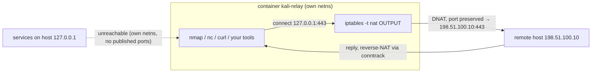

# kali-isolated-relay

[](https://github.com/null3302/kali-isolated-relay/actions/workflows/ci.yml)
[](LICENSE)
[](https://hub.docker.com/r/kalilinux/kali-rolling)
[](https://docs.docker.com/)

**Make `127.0.0.1` inside a Kali container mean a remote server's `127.0.0.1`.**

A single long-running Kali container whose entire loopback range (`127.0.0.0/8`) is
transparently DNAT-ed to a target host, **port preserved 1:1**. The container keeps its own
network namespace and its own loopback, so services listening on the host's `127.0.0.1` stay
invisible to it. No published ports, no `network_mode: host`, and no automatic image updates —
ever — unless you explicitly ask for them.

[中文文档](README.zh-CN.md) · [Test report](docs/TEST-REPORT.md)

---

## Table of contents

- [Why](#why)
- [Features](#features)
- [Architecture](#architecture)
- [Requirements](#requirements)
- [Install](#install)
- [Quick start](#quick-start)
- [Usage](#usage)
- [Configuration](#configuration)
- [Update policy](#update-policy)
- [Security model](#security-model)
- [Capabilities & limitations](#capabilities--limitations)
- [Repository layout](#repository-layout)
- [FAQ](#faq)
- [Development & verification](#development--verification)
- [Contributing](#contributing)
- [License](#license)

## Why

Security tooling is full of tools that hard-code `127.0.0.1`. When you want those tools to talk
to a *remote* host, you end up rewriting configs, tunneling ports one by one, or giving up and
testing against your own machine.

`kali-isolated-relay` flips it around: start one container, tell it a target IP, and every
program inside it that touches `127.0.0.1:<port>` transparently reaches `<TARGET_IP>:<port>` —
`nmap`, `nc`, `curl`, `ping`, your own scripts, anything. The container is also a real isolation
boundary: nothing on the host's loopback is reachable from inside.

## Features

- **Transparent relay** — `127.0.0.1:<port>` → `<TARGET_IP>:<port>`, same port, no per-port config.
- **Real isolation** — separate network namespace and separate loopback; host `127.0.0.1` services are unreachable.
- **Resident by design** — start once, keep working with `docker exec`; no `docker run` per command.
- **Safe defaults** — no `ports:`, no host network, only `NET_ADMIN` + `NET_RAW` capabilities.
- **Fully offline by default** — the base image is never pulled automatically; `-Update` is the only network path.
- **Traceable target** — the target IP is stored as a container label, so switching targets is detected, not guessed.
- **Batteries included** — `iptables`, `iproute2`, `nmap`, `iputils-ping`, `netcat-traditional`, `curl`, `socat`, `dnsutils`, `conntrack`, `tcpdump`.
- **Verified** — 17 acceptance assertions (TCP/UDP/ICMP/DNS/isolation/residency/update); see [docs/TEST-REPORT.md](docs/TEST-REPORT.md).

## Architecture



```text
┌──────────────── container kali-relay (own network namespace) ─────────────────┐
│  tools: nmap / nc / curl / ...                                                │
│         │ connect 127.0.0.1:443                                               │
│         ▼                                                                     │
│  [ iptables -t nat OUTPUT ]  DNAT 127.0.0.0/8 → 198.51.100.10 (port 1:1)      │
│  [ iptables -t nat POSTROUTING ]  MASQUERADE → source becomes container IP    │
└─────────┼─────────────────────────────────────────────────────────────────────┘
          ▼
   ┌────────────────────────────┐
   │ remote host 198.51.100.10  │
   └────────────────────────────┘

host 127.0.0.1:xxxx : unreachable from the container (own netns + no published ports)
Docker embedded DNS : 127.0.0.11:53 is explicitly RETURNed (both directions), DNS keeps working
```

The exact rules written by `entrypoint.sh` (visible via `iptables-save` inside the container):

```bash
# nat: transparent DNAT, port preserved
iptables -t nat -N KALI-RELAY
iptables -t nat -A KALI-RELAY -s 127.0.0.11/32 -j RETURN          # embedded DNS replies
iptables -t nat -A KALI-RELAY -d 127.0.0.11/32 -j RETURN          # embedded DNS queries
iptables -t nat -A KALI-RELAY -d 127.0.0.0/8 -p tcp  -j DNAT --to-destination <TARGET_IP>
iptables -t nat -A KALI-RELAY -d 127.0.0.0/8 -p udp  -j DNAT --to-destination <TARGET_IP>
iptables -t nat -A KALI-RELAY -d 127.0.0.0/8 -p icmp -j DNAT --to-destination <TARGET_IP>

# nat: reply path SNAT (mandatory) — after DNAT the source is still 127.0.0.1,
# which cannot leave the container; masquerade it with the container's own address.
iptables -t nat -N KALI-RELAY-POST
iptables -t nat -A KALI-RELAY-POST -d <TARGET_IP> -j MASQUERADE

# filter: safety net — any 127/8 traffic that escaped DNAT is dropped
iptables -N KALI-RELAY-OUT
iptables -A KALI-RELAY-OUT -s 127.0.0.11/32 -j RETURN
iptables -A KALI-RELAY-OUT -d 127.0.0.11/32 -j RETURN
iptables -A KALI-RELAY-OUT -d 127.0.0.0/8   -j DROP
```

> Why both `127.0.0.11` RETURNs matter: Docker's embedded DNS **reply** is
> "source `127.0.0.11`, destination `127.0.0.1`" and it also traverses the container's
> `OUTPUT` chain. Drop the `-s 127.0.0.11` rule and DNS replies get DNAT-ed/dropped,
> which looks exactly like "name resolution times out inside the container".

## Requirements

| Item | Requirement |
| --- | --- |
| Docker | Docker Desktop for Windows, or Docker Engine 24+ on Linux (kernel with `nf_nat`) |
| PowerShell | Windows PowerShell 5.1 or PowerShell 7+ |
| Disk | ~1.5 GB (base image + tooling) |
| Capabilities | `NET_ADMIN`, `NET_RAW` (already declared by the script and Compose file) |
| Network | the container must reach `TARGET_IP`; the first build needs access to Kali mirrors |

## Install

```powershell
git clone https://github.com/null3302/kali-isolated-relay.git
cd kali-isolated-relay
```

All paths in the scripts are derived from `$PSScriptRoot`, so the project works from any directory.
Avoid deep paths containing non-ASCII characters or spaces — the Docker build context is happier.

## Quick start

```powershell
# 1. build (first run only), start the container, and open an interactive shell
.\start-relay.ps1 -t 198.51.100.10

# 2. from another window: run a single command inside the container
.\start-relay.ps1 -t 198.51.100.10 -Cmd "nmap -sT 127.0.0.1"
```

`198.51.100.10` is an RFC 5737 documentation address — replace it with a host **you are allowed to test**.

First build timing: Kali base image ≈130 MB + ≈400 MB of tooling, roughly 3–15 minutes
depending on your mirror.

## Usage

### Interactive shell

```powershell
.\start-relay.ps1 -t 198.51.100.10
# or, when the container is already running:
docker exec -it kali-relay /bin/bash
```

`exit` leaves the shell; the container keeps running and the rules stay in place.

### Single command

```powershell
.\start-relay.ps1 -t 198.51.100.10 -Cmd "nc -zv 127.0.0.1 443"
.\start-relay.ps1 -t 198.51.100.10 -Cmd "nmap -sT 127.0.0.1"
.\start-relay.ps1 -t 198.51.100.10 -Cmd "ping -c 3 127.0.0.1"
```

Executed as `docker exec -it kali-relay /bin/bash -lc "<Cmd>"`; the exit code is propagated.

> **Tools must live inside the container.** A tool installed on the host cannot see the
> container's loopback. Install it into the container and run it there:
> `docker exec -it kali-relay /bin/bash -lc "apt-get install -y <tool>"`.

### Status / stop

```powershell
.\start-relay.ps1 -Status          # container state, target, health, published ports, live nat rules
.\start-relay.ps1 -Stop            # remove container + dedicated network, keep the image
.\start-relay.ps1 -Stop -Purge     # also remove kali-relay:latest
```

### Switch target

```powershell
.\start-relay.ps1 -t 192.0.2.20          # prompts before recreating
.\start-relay.ps1 -t 192.0.2.20 -Force   # non-interactive / no prompt
```

The current target is stored as the container label `kali-relay.target-ip`:

```powershell
docker inspect -f '{{index .Config.Labels "kali-relay.target-ip"}}' kali-relay
```

### Docker Compose (alternative to the script)

```powershell
$env:TARGET_IP = '198.51.100.10'
docker compose up -d --build
docker exec -it kali-relay /bin/bash
docker compose down
```

The Compose service is equivalent: same image, same isolated bridge network, same capabilities,
no published ports.

## Configuration

### `start-relay.ps1` parameters

| Parameter | Type | Default | Description |
| --- | --- | --- | --- |
| `-t <IP>` | string | — | Target IPv4 address. Required unless `-Status`/`-Stop` are used alone |
| `-Cmd <command>` | string | empty | Run one command in the container; empty means interactive shell |
| `-Update` | switch | off | Pull the latest base image, rebuild with `--no-cache`, recreate the container |
| `-Rebuild` | switch | off | Rebuild the image from the local base image (no network) |
| `-Force` | switch | off | Recreate without prompting (target change / rebuild) |
| `-Status` | switch | off | Show state and live rules |
| `-Stop` | switch | off | Remove container and dedicated network |
| `-Purge` | switch | off | With `-Stop`: also remove the image |
| `-KaliBaseTag <tag>` | string | `latest` | Base image tag (`KALI_BASE_TAG` build arg) |
| `-DockerHost <endpoint>` | string | — | Advanced: talk to a remote Docker endpoint |

### Constants

| Name | Value | Notes |
| --- | --- | --- |
| Container | `kali-relay` | fixed; referenced by the script and docs |
| Image | `kali-relay:latest` | fixed |
| Network | `kali-relay-net` | dedicated bridge, no published ports |
| Subnet | `172.28.0.0/24` | pinned so the acceptance script is deterministic; change `$NetworkSubnet` and the Compose `ipam` block if it clashes |
| Capabilities | `NET_ADMIN`, `NET_RAW` | iptables + raw sockets |
| Sysctls | `net.ipv4.conf.all.route_localnet=1` | lets the kernel treat 127/8 as routable |
| Env | `TARGET_IP` | read by `entrypoint.sh` |
| Build arg | `KALI_BASE_TAG` | defaults to `latest` |

## Update policy

| Situation | Network | Behaviour |
| --- | --- | --- |
| First run (no image) | yes (base image + apt) | `docker build` |
| Image exists, no `-Update` | **no** | reuse the local image; never pulls silently |
| `-Rebuild` | **no** | rebuild from the local base image |
| `-Update` | yes | `docker pull kalilinux/kali-rolling:<tag>` → `docker build --no-cache` → recreate container |

`-Update` re-downloads the Kali base image and reinstalls every tool (usually 5–15 minutes).
It is the **only** code path that touches the network for images.

## Security model

**Why not `network_mode: host`?** With host networking the container shares the host's network
namespace, so its `127.0.0.1` *is* the host's `127.0.0.1`: every container process could reach
local databases and admin ports, the DNAT rules would also rewrite the host's own loopback
traffic, and the isolation goal becomes impossible.

**Why no published ports?** `ports:` exposes container ports on the host (default `0.0.0.0`),
which is an inbound attack surface and irrelevant here — the relay happens on the **outbound**
path, so it needs no inbound port at all.

**How to verify the host loopback is not exposed:**

```powershell
docker port kali-relay                                          # empty
docker inspect -f '{{.HostConfig.NetworkMode}}' kali-relay      # kali-relay-net, not host
```

Plus a live check: start `python3 -m http.server 18080 --bind 127.0.0.1` on the host, then
`docker exec kali-relay curl 127.0.0.1:18080` from inside — it must fail
(this is assertion #6 of [tests/acceptance.sh](tests/acceptance.sh)).

> ⚠️ This is **not** a multi-tenant security boundary. The container still reaches whatever
> network it could reach before, and can launch scans from inside. Only point it at hosts you
> are authorised to test.

## Capabilities & limitations

| Capability | Result | Notes |
| --- | --- | --- |
| TCP, single port | ✅ equivalent | `nc -zv 127.0.0.1 <port>` matches the direct result |
| TCP, many ports | ✅ equivalent | `nmap -sT 127.0.0.1` matches the direct result; ports are 1:1 |
| `nmap -sS` on `127.0.0.1` | ⚠️ not usable | raw-socket SYNs keep the `lo` route and never leave the container; use `nmap -sT` or run `-sS` against `<TARGET_IP>` |
| UDP data path | ✅ equivalent | `nc -u` and application UDP work; replies rely on conntrack |
| `nmap -sU` on `127.0.0.1` | ⚠️ state unreliable | may report `open\|filtered`; trust the direct scan for UDP port state |
| ICMP | ✅ equivalent | `ping 127.0.0.1` really pings the target, so RTT is the path RTT |
| DNS | ✅ works | `127.0.0.11:53` allowed in both directions |
| `::1` (IPv6 loopback) | ❌ not relayed | this design covers IPv4 loopback only |
| UNIX sockets | ➖ unaffected | `/var/run/*.sock` does not traverse the IP stack |
| "local identity" services | ⚠️ note | the target sees the container's address, not a loopback client |

Full command output, kernel counters and rule dumps: [docs/TEST-REPORT.md](docs/TEST-REPORT.md).

## Repository layout

```text
kali-isolated-relay/
├── Dockerfile                 # Kali base + tooling + entrypoint
├── entrypoint.sh              # installs iptables rules, then stays resident
├── docker-compose.yml         # declarative alternative (same behaviour)
├── start-relay.ps1            # lifecycle + command entry point (Windows)
├── README.md                  # this file
├── README.zh-CN.md            # Chinese version
├── LICENSE                    # MIT
├── CHANGELOG.md
├── CONTRIBUTING.md
├── CODE_OF_CONDUCT.md
├── SECURITY.md
├── .gitignore / .dockerignore / .gitattributes
├── .github/
│   ├── ISSUE_TEMPLATE/{bug_report,feature_request}.md
│   ├── PULL_REQUEST_TEMPLATE.md
│   └── workflows/ci.yml
├── docs/
│   └── TEST-REPORT.md         # measured results, environment, raw output
├── scripts/
│   └── privacy-scan.ps1       # pre-publish secret/PII scan
└── tests/
    └── acceptance.sh          # repeatable acceptance suite
```

## FAQ

**Why is `ping 127.0.0.1` showing a few milliseconds instead of microseconds?**
Because it pings the target host — the DNAT is working as intended.

**`curl 127.0.0.1:8080` inside the container says connection refused, but the target does listen.**
Ports are 1:1, so check the port number first; then confirm the container can reach the target at
all: `docker exec kali-relay ping <TARGET_IP>`.

**DNS does not resolve inside the container.**
The rules already allow `127.0.0.11:53` in both directions; check
`docker exec kali-relay cat /etc/resolv.conf` and the host resolver. Using bare IPs is the most
robust option with this design.

**Can one container relay to several targets?**
Not currently: one container, one target. Run multiple instances and change the container/image
constants at the top of `start-relay.ps1`.

**Does `-Stop` delete the image?**
No, only with `-Purge`.

**Windows: `docker exec -it` complains "the input device is not a TTY".**
The script detects a non-interactive terminal and falls back to `-i`, which runs the command
without a TTY.

**Why does `nmap -sS 127.0.0.1` show `filtered` while `nmap -sT 127.0.0.1` works?**
`-sS` builds packets on a raw socket; the kernel already picked the `lo` route for destination
`127.0.0.1` before netfilter runs, and DNAT does not re-route those packets, so the SYN dies on
`lo`. `nat/OUTPUT` cannot `SNAT` either (measured: `RULE_INSERT failed (Invalid argument)`), so
the source cannot be rewritten before routing. Use `-sT`, or scan the target IP with `-sS`.

## Development & verification

```bash
# on the Docker host (Linux/macOS, or a WSL2 distro)
shellcheck entrypoint.sh tests/acceptance.sh

# spin up a local target container on the pinned subnet and compare behaviours
./tests/acceptance.sh --fixture                 # target defaults to 172.28.0.10
./tests/acceptance.sh --target 198.51.100.10    # or compare against a real remote host
```

Windows side:

```powershell
Invoke-ScriptAnalyzer -Path ./start-relay.ps1 -Severity Warning,Error
docker compose config
pwsh ./scripts/privacy-scan.ps1
```

CI lives in [.github/workflows/ci.yml](.github/workflows/ci.yml): shellcheck, PSScriptAnalyzer,
`docker build`, plus smoke tests for the rule chain and the "no published ports" constraint.

## Contributing

See [CONTRIBUTING.md](CONTRIBUTING.md) and [CODE_OF_CONDUCT.md](CODE_OF_CONDUCT.md).
Please report security issues privately, as described in [SECURITY.md](SECURITY.md).

All documentation examples use RFC 5737 documentation addresses
(`192.0.2.0/24`, `198.51.100.0/24`, `203.0.113.0/24`) — they never refer to real hosts.
Run `pwsh ./scripts/privacy-scan.ps1` before opening a PR.

## License

[MIT](LICENSE) © 2026 null3302
