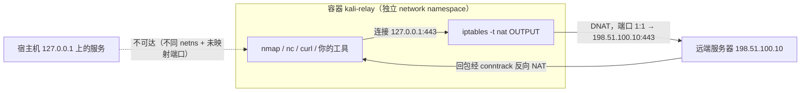

# kali-isolated-relay

[](https://github.com/null3302/kali-isolated-relay/actions/workflows/ci.yml)
[](LICENSE)
[](https://www.kali.org/)

**让 Kali 容器里的 `127.0.0.1` 等价于一台远端服务器的 `127.0.0.1`。**

[English](README.md) · [测试报告](docs/TEST-REPORT.md)

用一个常驻 Kali 容器把容器内部回环 `127.0.0.1` 透明 DNAT 到指定远端主机，端口 1:1 保持不变；
宿主机本地回环服务与容器彻底隔离；默认不发布任何端口、不使用 host 网络。

> **English TL;DR** — A long-running Kali container whose loopback (`127.0.0.1`) is transparently
> DNAT-ed to a remote host on the same port. The container keeps its own isolated network namespace,
> publishes no ports, and never uses `network_mode: host`. Tested on Linux/Docker 28; see
> [docs/TEST-REPORT.md](docs/TEST-REPORT.md).

---

## 目录

- [特性](#特性)
- [架构](#架构)
- [前提条件](#前提条件)
- [安装](#安装)
- [快速开始](#快速开始)
- [使用方法](#使用方法)
- [配置项](#配置项)
- [更新策略](#更新策略)
- [安全说明](#安全说明)
- [能力与限制](#能力与限制)
- [目录结构](#目录结构)
- [常见问题](#常见问题)
- [开发与验收](#开发与验收)
- [隐私与占位符](#隐私与占位符)
- [贡献](#贡献)
- [许可证](#许可证)

## 特性

- **透明转发**：容器内任何程序访问 `127.0.0.1:<端口>`，等价于访问 `TARGET_IP:<端口>`，端口不改变。
- **真正的隔离**：容器有独立 loopback；宿主机 `127.0.0.1` 上开放的服务对容器不可见。
- **常驻**：一次启动长期运行，之后用 `docker exec` / `.\start-relay.ps1 -Cmd` 干活，无需反复 `docker run`。
- **默认不发布端口**：不写 `ports`，不用 `network_mode: host`，宿主机攻击面不增加。
- **更新可控**：默认完全离线使用本地镜像；只有显式 `-Update` 才会 `docker pull` 最新 Kali 并重建。
- **目标可追溯**：目标 IP 记录在容器 label 里，换目标时会检测并提示重建。
- **开箱即用**：镜像内已装 `iptables`、`iproute2`、`nmap`、`iputils-ping`、`netcat-traditional`、`curl`、`socat`、`dnsutils`、`conntrack`、`tcpdump`。

## 架构



```text
┌─────────────────── 容器 kali-relay（独立 network namespace）───────────────────┐
│  工具：nmap / nc / curl ...                                                    │
│        │ 连接 127.0.0.1:443                                                    │
│        ▼                                                                       │
│  [ iptables -t nat OUTPUT ]  DNAT 127.0.0.0/8 → 198.51.100.10（端口保持 1:1）   │
└────────┼───────────────────────────────────────────────────────────────────────┘
         │
         ▼
   ┌───────────────────────────┐
   │ 远端服务器 198.51.100.10  │
   └───────────────────────────┘

宿主机 127.0.0.1:xxxx 上的服务：容器完全看不到（独立 netns + 未发布端口）
Docker 内置 DNS 127.0.0.11:53：显式 RETURN，不做 DNAT，保证容器内域名解析可用
```

规则实现（`entrypoint.sh` 实际写入，容器内 `iptables-save` 可见）：

```bash
# nat 表：透明转发（端口 1:1）
iptables -t nat -N KALI-RELAY
iptables -t nat -A KALI-RELAY -s 127.0.0.11/32 -j RETURN          # Docker 内置 DNS 的回包
iptables -t nat -A KALI-RELAY -d 127.0.0.11/32 -j RETURN          # Docker 内置 DNS 的查询
iptables -t nat -A KALI-RELAY -d 127.0.0.0/8 -p tcp  -j DNAT --to-destination <TARGET_IP>
iptables -t nat -A KALI-RELAY -d 127.0.0.0/8 -p udp  -j DNAT --to-destination <TARGET_IP>
iptables -t nat -A KALI-RELAY -d 127.0.0.0/8 -p icmp -j DNAT --to-destination <TARGET_IP>

# nat 表：回程 SNAT（关键）—— DNAT 后源地址仍是 127.0.0.1，不做 SNAT 包出不了容器
iptables -t nat -N KALI-RELAY-POST
iptables -t nat -A KALI-RELAY-POST -d <TARGET_IP> -j MASQUERADE

# filter 表：兜底隔离（任何漏过 DNAT 的 127/8 流量一律丢弃）
iptables -N KALI-RELAY-OUT
iptables -A KALI-RELAY-OUT -s 127.0.0.11/32 -j RETURN
iptables -A KALI-RELAY-OUT -d 127.0.0.11/32 -j RETURN
iptables -A KALI-RELAY-OUT -d 127.0.0.0/8   -j DROP
```

> 为什么两条 `127.0.0.11` 的 `RETURN` 都要保留：Docker 内置 DNS 的**回包**是
> "源 `127.0.0.11`、目的 `127.0.0.1`"，它同样经过容器的 `OUTPUT` 链；
> 少了 `-s 127.0.0.11 -j RETURN`，回包会被 DNAT/丢弃，表现就是"容器内域名解析超时"。

## 前提条件

| 项目 | 要求 |
| --- | --- |
| Docker | Docker Desktop for Windows / Docker Engine 24+（Linux 内核需支持 `nf_nat`） |
| PowerShell | Windows PowerShell 5.1 或 PowerShell 7+ |
| 磁盘 | 约 1.5 GB（基础镜像 + 工具） |
| 权限 | 启动容器需要 `NET_ADMIN`、`NET_RAW`（脚本/Compose 已声明） |
| 网络 | 容器能直连 `TARGET_IP`（首构建时需能访问 Kali 镜像源） |

> Windows 用户只需安装 [Docker Desktop](https://docs.docker.com/desktop/setup/install/windows-install/)，
> 并确保 `docker version` 能同时显示 Client 与 Server。

## 安装

```powershell
git clone https://github.com/null3302/kali-isolated-relay.git
cd kali-relay
```

也可以直接下载 ZIP 解压。脚本内所有路径都基于 `$PSScriptRoot`，可放在任意目录（**不要放进含中文/空格的深层路径**以免 docker 构建上下文出问题）。

## 快速开始

```powershell
# 1. 启动（首次会自动构建镜像 + 创建容器），并进入容器交互 shell
.\start-relay.ps1 -t 198.51.100.10

# 2. 在另一个窗口执行单条命令（容器已在跑，不会重建）
.\start-relay.ps1 -t 198.51.100.10 -Cmd "nmap -sT 127.0.0.1"
```

> `198.51.100.10` 是 RFC 5737 文档保留地址，请替换成你**有权测试**的目标 IP。

首次构建耗时参考：Kali 基础镜像约 130 MB，`apt` 安装工具约 400 MB，视网络情况 3–15 分钟。

## 使用方法

### 1. 进入交互式 shell

```powershell
.\start-relay.ps1 -t 198.51.100.10
# 或者容器已启动时：
docker exec -it kali-relay /bin/bash
```

退出 shell 用 `exit`，**容器继续常驻**，规则持续生效。

### 2. 执行单条命令

```powershell
.\start-relay.ps1 -t 198.51.100.10 -Cmd "nc -zv 127.0.0.1 443"
.\start-relay.ps1 -t 198.51.100.10 -Cmd "nmap -sT 127.0.0.1"
.\start-relay.ps1 -t 198.51.100.10 -Cmd "ping -c 3 127.0.0.1"
```

命令通过 `docker exec -it kali-relay /bin/bash -lc "<Cmd>"` 执行，退出码会原样透传。

> **工具必须装在容器里**：宿主机上的工具用不上容器内的 `127.0.0.1`。
> 正确姿势是把工具装进容器，再用 `-Cmd` 或 `docker exec` 在容器内运行：
> `docker exec -it kali-relay /bin/bash -lc "apt-get install -y <tool>"`。

### 3. 查看状态

```powershell
.\start-relay.ps1 -Status
```

输出容器状态、目标 IP、健康状态、是否发布端口、当前 `nat` 规则与 `route_localnet` 值。

### 4. 停止 / 清理

```powershell
.\start-relay.ps1 -Stop          # 停止并删除容器与专用网络，保留镜像（下次启动更快）
.\start-relay.ps1 -Stop -Purge  # 连 kali-relay:latest 镜像一起删除
```

### 5. 更换目标 IP

```powershell
# 直接换：脚本检测到目标不一致会提示确认
.\start-relay.ps1 -t 192.0.2.20

# 非交互环境 / 想免确认
.\start-relay.ps1 -t 192.0.2.20 -Force
```

目标 IP 记录在容器 label `kali-relay.target-ip` 上，可用
`docker inspect -f '{{index .Config.Labels "kali-relay.target-ip"}}' kali-relay` 查看。

### 6. 用 Docker Compose 启动（与脚本二选一）

```powershell
$env:TARGET_IP = '198.51.100.10'
docker compose up -d --build
docker exec -it kali-relay /bin/bash
docker compose down
```

`docker-compose.yml` 与脚本产出的容器配置一致（同样不发布端口、独立 bridge 网络、`NET_ADMIN`/`NET_RAW`）。

## 配置项

### start-relay.ps1 参数

| 参数 | 类型 | 默认值 | 说明 |
| --- | --- | --- | --- |
| `-t <IP>` | string | 无 | 目标 IPv4 地址。除 `-Status`/`-Stop` 单独使用外必填 |
| `-Cmd <命令>` | string | 空 | 在容器内执行一条命令；为空则进入交互 shell |
| `-Update` | switch | off | 显式更新：`docker pull` 最新基础镜像 + `--no-cache` 重建镜像 + 重建容器 |
| `-Rebuild` | switch | off | 只重建镜像，不联网更新基础镜像 |
| `-Force` | switch | off | 目标 IP 不一致 / 容器需重建时不再询问 |
| `-Status` | switch | off | 查看状态与规则 |
| `-Stop` | switch | off | 停止并删除容器与专用网络 |
| `-Purge` | switch | off | 配合 `-Stop`，连同镜像一起删除 |
| `-KaliBaseTag <tag>` | string | `latest` | 基础镜像标签，对应 Dockerfile 的 `KALI_BASE_TAG` |
| `-DockerHost <端点>` | string | 空 | 高级用法：连接远端 Docker（如 `tcp://127.0.0.1:2375`） |

### 容器 / 镜像常量

| 名称 | 值 | 说明 |
| --- | --- | --- |
| 容器名 | `kali-relay` | 固定，脚本与文档均依赖 |
| 镜像名 | `kali-relay:latest` | 固定 |
| 网络名 | `kali-relay-net` | 独立 bridge 网络，无端口发布 |
| 网络网段 | `172.28.0.0/24` | 固定网段，便于验收脚本稳定取值；与内网冲突时可改（`start-relay.ps1` 的 `$NetworkSubnet` 与 compose 的 `ipam`） |
| 能力 | `NET_ADMIN`, `NET_RAW` | 配置 iptables / 抓包 |
| sysctl | `net.ipv4.conf.all.route_localnet=1` | 允许把 127/8 视作可转发目标 |
| 环境变量 | `TARGET_IP` | 容器内由 `entrypoint.sh` 读取 |
| 构建参数 | `KALI_BASE_TAG` | 选择基础镜像标签，默认 `latest` |

## 更新策略

| 场景 | 是否联网 | 行为 |
| --- | --- | --- |
| 首次运行（无镜像） | ✅ 是（拉基础镜像 + apt） | `docker build` |
| 已有镜像、不传 `-Update` | ❌ 否 | 直接复用本地镜像，**绝不**自动 `docker pull` |
| `-Rebuild` | ❌ 否 | 用本地基础镜像重建项目镜像 |
| `-Update` | ✅ 是 | `docker pull kalilinux/kali-rolling:<tag>` → `docker build --no-cache` → 重建容器 |

`-Update` 会重新下载 Kali 基础镜像并重装全部工具，**耗时较长**（通常 5–15 分钟，取决于网络），
这是唯一会主动联网更新基础镜像的入口。

## 安全说明

### 为什么不使用 `network_mode: host`

host 网络会让容器与宿主机共用同一个 network namespace，容器内的 `127.0.0.1` 就等于宿主机的 `127.0.0.1`：

- 容器里任何程序都能直接访问宿主机本地服务（数据库、管理端口、agent 等）；
- DNAT `127/8` 的规则会同时影响宿主机自己的回环流量；
- 隔离目标（需求三）根本不可能达成。

因此本项目始终坚持独立 bridge 网络 + 独立 netns。

### 为什么不把端口映射到宿主机

`ports:` 会把容器端口发布到宿主机（默认 `0.0.0.0`），等于给宿主机新开入口，且与"容器内 127.0.0.1 转发到远端"的目标无关——
转发发生在容器**出方向**，不需要任何入方向端口。

### 如何确认宿主机回环服务没被暴露

```powershell
docker port kali-relay          # 应输出为空
docker inspect -f '{{.HostConfig.NetworkMode}}' kali-relay   # 应为 kali-relay-net，不是 host
```

再加一条实测：宿主机开 `python3 -m http.server 18080 --bind 127.0.0.1`，容器内 `curl 127.0.0.1:18080` 必须失败
（[tests/acceptance.sh](tests/acceptance.sh) 的第 6 项会自动做这件事）。

> ⚠️ 这不是多租户安全边界：容器仍然能访问它原本就能访问的网络，也能在内部发起任意扫描。
> 请只在你有权测试的目标上使用。

## 能力与限制

<!-- 下表为实测结论，测试环境与命令见 docs/TEST-REPORT.md -->

| 能力 | 结论 | 说明 |
| --- | --- | --- |
| TCP 单端口 | ✅ 等价 | `nc -zv 127.0.0.1 <port>` 与直连目标结果一致 |
| TCP 多端口 / 全端口 | ✅ 等价 | `nmap -sT 127.0.0.1` 与直连结果一致；端口 1:1 保持，无需逐端口配置 |
| SYN 扫描 `nmap -sS` | ⚠️ 不适用于 `127.0.0.1` | 原始套接字报文在 DNAT 后仍走 `lo`、不会离开容器（实测见测试报告）；请用 `nmap -sT`，或直接对 `<TARGET_IP>` 做 `-sS` |
| UDP 数据面 | ✅ 等价 | `nc -u` / 应用层 UDP 收发正常，回包依赖 conntrack |
| UDP 端口扫描 `nmap -sU` | ⚠️ 状态判定不可靠 | 同样受原始套接字探测影响，端口可能显示 `open\|filtered`；UDP 端口状态请以直连目标为准 |
| ICMP | ✅ 等价 | `ping 127.0.0.1` 实际 ping 的是目标主机，时延为到目标的 RTT |
| DNS | ✅ 可用 | `127.0.0.11:53` 双向放行，容器内域名解析正常 |
| `::1`（IPv6 回环） | ❌ 不转发 | 本方案只处理 IPv4 回环 |
| UNIX socket | ➖ 不受影响 | `/var/run/*.sock` 不经过 IP 栈 |
| 需要"本机身份"的服务 | ⚠️ 需注意 | 目标侧看到的是容器源地址（DNAT+SNAT 后），不是"本地回环" |

实测细节、命令与原始输出见 [docs/TEST-REPORT.md](docs/TEST-REPORT.md)。

## 目录结构

```text
kali-relay/
├── Dockerfile                 # Kali 基础镜像 + 工具 + entrypoint
├── entrypoint.sh              # 配置 iptables 规则并常驻
├── docker-compose.yml         # 声明式启动（与脚本等价，二选一）
├── start-relay.ps1            # 生命周期管理 / 命令入口（Windows）
├── README.md
├── LICENSE                    # MIT（作者为占位符）
├── CHANGELOG.md
├── CONTRIBUTING.md
├── CODE_OF_CONDUCT.md
├── SECURITY.md
├── .gitignore / .dockerignore / .gitattributes
├── .github/
│   ├── ISSUE_TEMPLATE/
│   │   ├── bug_report.md
│   │   └── feature_request.md
│   ├── PULL_REQUEST_TEMPLATE.md
│   └── workflows/ci.yml
├── docs/
│   └── TEST-REPORT.md         # 实测报告（环境、命令、输出摘要）
├── scripts/
│   └── privacy-scan.ps1       # 发布前敏感信息扫描
└── tests/
    └── acceptance.sh          # 可重复执行的验收脚本
```

## 常见问题

**Q：为什么 `ping 127.0.0.1` 的延迟是几毫秒而不是 0.0x 毫秒？**
A：因为它实际上 ping 的是目标主机（DNAT 已生效）。这正是设计目标。

**Q：为什么 `nmap -sS 127.0.0.1` 显示 `filtered`，而 `nmap -sT 127.0.0.1` 正常？**
A：`-sS` 用原始套接字自己构造报文，内核在 netfilter 之前已按目的地址 `127.0.0.1` 选定 `lo` 路由，
DNAT 改写目的地址后不会为这类报文重新选路，SYN 就停在 `lo` 上而不会离开容器。
这是 `iptables` OUTPUT DNAT 的固有限制（`nat/OUTPUT` 不允许 `SNAT`，无法在选路前改源地址）。
请改用 `nmap -sT 127.0.0.1`（结果与直连完全一致），或直接对 `<TARGET_IP>` 做 `-sS`。
`nmap -sU` 同理：UDP 业务可用，但端口状态判定请以直连为准。

**Q：容器内 `curl 127.0.0.1:8080` 提示 connection refused，但目标上确实有服务？**
A：确认端口一致（本方案 1:1，不改变端口），并确认容器能直连目标：`docker exec kali-relay ping <TARGET_IP>`。

**Q：容器内域名解析失败？**
A：`entrypoint.sh` 已对 `127.0.0.11:53` 放行。若仍失败，检查 `docker exec kali-relay cat /etc/resolv.conf`
与宿主 DNS。本方案建议**优先使用 IP**，域名解析依赖宿主网络。

**Q：能不能把 127.0.0.1 转发到多个目标？**
A：当前设计是"一个容器一个目标"。需要多目标时，启动多个容器实例并改为不同容器名（`kali-relay` 常量在脚本顶部）。

**Q：`-Stop` 会删镜像吗？**
A：不会。镜像保留，除非加 `-Purge`。

**Q：Windows 上 `docker exec -it` 报 "the input device is not a TTY"？**
A：脚本已处理：检测到非交互终端时自动降级为 `-i`，只执行命令不开 TTY。

## 开发与验收

```bash
# 在 Docker 主机（Linux/macOS，或 WSL2 内的 Linux）上运行
shellcheck entrypoint.sh tests/acceptance.sh

# 起一个本地靶机做可断言的一致性测试（靶机占用 --target 指定的 IP）
./tests/acceptance.sh --target 172.28.0.10 --fixture
```

Windows 侧：

```powershell
Invoke-PSScriptAnalyzer -Path ./start-relay.ps1 -Severity Warning,Error
docker compose config
```

CI 见 [.github/workflows/ci.yml](.github/workflows/ci.yml)。

## 隐私与占位符

- **示例地址**：文档与代码示例中的 IP 一律使用 RFC 5737 文档保留地址
  （`192.0.2.0/24`、`198.51.100.0/24`、`203.0.113.0/24`），不对应任何真实主机。
- **联系方式**：本项目不公开个人邮箱，问题与安全报告一律通过 GitHub 处理
  （维护者 [@null3302](https://github.com/null3302)；安全问题见 [SECURITY.md](SECURITY.md)）。

- **提交前自检**：

  ```powershell
  pwsh ./scripts/privacy-scan.ps1
  ```

  扫描本机路径、用户名、主机名、邮箱、常见 token 前缀与非文档保留地址，发现即报错退出。

## 贡献

见 [CONTRIBUTING.md](CONTRIBUTING.md) 与 [CODE_OF_CONDUCT.md](CODE_OF_CONDUCT.md)。
安全漏洞请按 [SECURITY.md](SECURITY.md) 私下报告。

## 许可证

[MIT](LICENSE) © 2026 null3302
